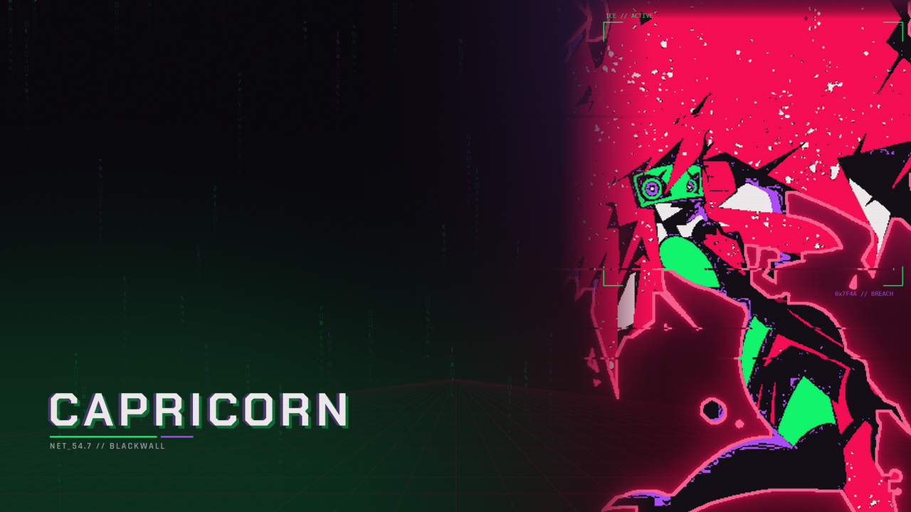
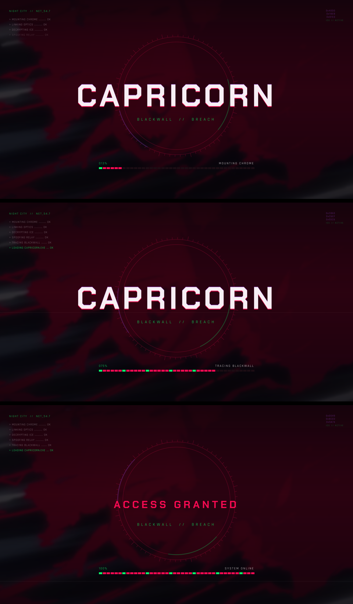

# Capricorn — a Cyberpunk Edgerunners 2 KDE rice

A full desktop transformation built around the *Capricorn* key art: black base,
wine-red canvas, acid green and violet accents, glitch everywhere.





## Palette

| role | colour |
|---|---|
| ink / background | `#050308` · `#0b0710` |
| primary red | `#ff2038` |
| wine | `#a3145e` |
| acid green | `#0dff6e` |
| violet | `#b14cff` |
| paper text | `#f4eff1` |

## What is inside

**Desktop**
- KDE colour scheme `CyberpunkCapricorn` + red accent
- `Capricorn-Glass` Plasma style — translucent panels (~38% alpha)
- Aurorae window decoration, repainted for the palette
- Lock screen (`com.capricorn.lock`): black background, branding, Capri avatar
- SDDM login theme (black, branded) — staged, needs `sudo` to install

**Animated wallpapers** (custom Plasma wallpaper plugins)
- `com.capricorn.glitch` — her portrait, glitch cuts, tilted clock, random
  `BLACKWALL TRACE` intrusion events, night tint
- `com.capricorn.blackwall` — black screen with red lightning

**Loading screen**
- full-screen boot animation in `ksplash` (runs before plasmashell):
  boot log, HUD ring, glitch title, progress, `ACCESS GRANTED`
- same animation after unlock, via a systemd user service

**Terminal**
- Konsole profile + colour scheme (transparent, blurred, red palette)
- kitty config, fish prompt/title, fastfetch, cava

**App themes**
- Equibop / Discord: Vencord QuickCSS (`Capricorn Glass`)
- Spotify: spicetify theme (`Capricorn`)
- Firefox: `userChrome.css` / `userContent.css`
- Heroic: `Capricorn.css` custom theme
- OpenCode: `themes/capricorn.json` (V2 TUI theme)

## Repository layout

```
apply.sh                 colour scheme + wallpaper + lock screen
animations.sh            KWin effects + boot splash
install.sh               applies the whole desktop side
install-sddm.sh          installs the login theme (sudo)
install-avatar.sh        sets the account avatar (sudo)
refresh-wallpaper.sh     pushes wallpapers with fresh URLs (cache-busting)
set-screens.sh           assigns wallpapers per monitor
verify.sh                health check: files, settings, wallpapers
revert.sh                restores pre-rice configs

generate_*.py            wallpaper / glitch / splash asset generators
make_wine_icons.py       icon recolouring (experimental, off by default)

sddm/capricorn/          staged SDDM theme
themes/                  OpenCode theme, extras
docs/                    preview images
art/                     source artwork used by the generators
```

## Install

Requirements: KDE Plasma 6, Konsole, fish, fastfetch, `rsvg-convert`,
python3 with Pillow and numpy.

```bash
git clone <your-repo-url> ~/Projekty/cyberpunk-capricorn
cd ~/Projekty/cyberpunk-capricorn
./install.sh          # desktop: colours, glass panels, decoration, splash, terminal
./verify.sh           # confirm everything landed
```

Optional, needs your password:

```bash
./install-sddm.sh     # login screen
./install-avatar.sh   # account avatar on the lock screen / SDDM / user menu
```

Notes:
- scripts assume the repo lives at `~/Projekty/cyberpunk-capricorn`; adjust the
  absolute paths inside them if you clone elsewhere
- SDDM is installed system-wide and survives reboots
- Spotify theming is reverted by Spotify updates: `spicetify backup apply`
- some assets in `art/` and `sddm/` are derived from third-party artwork and
  the Breeze SDDM theme; check their licenses before redistributing

## License

Code and configuration: MIT (see `LICENSE`).
Third-party artwork, Breeze assets and Papirus icons keep their own licenses.
